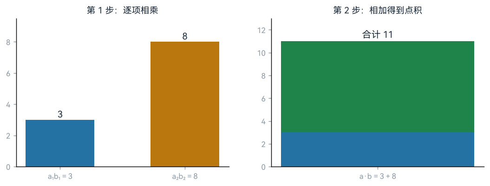
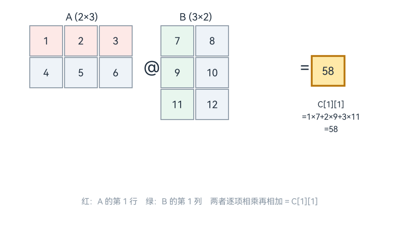
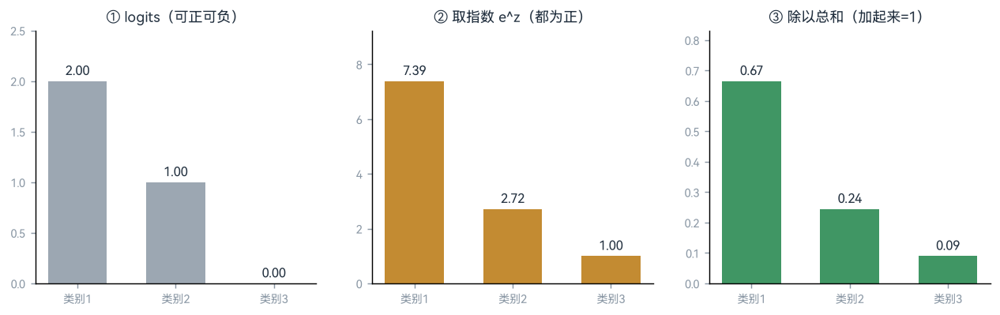
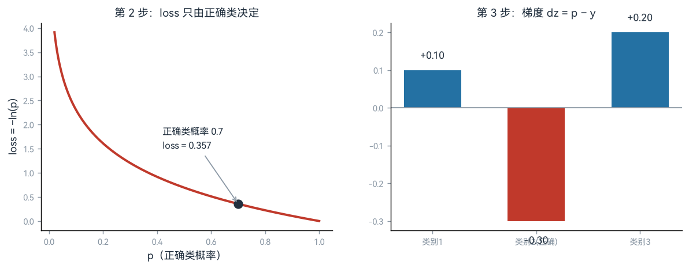
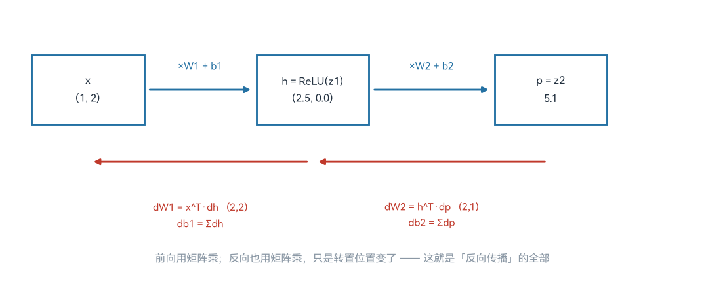
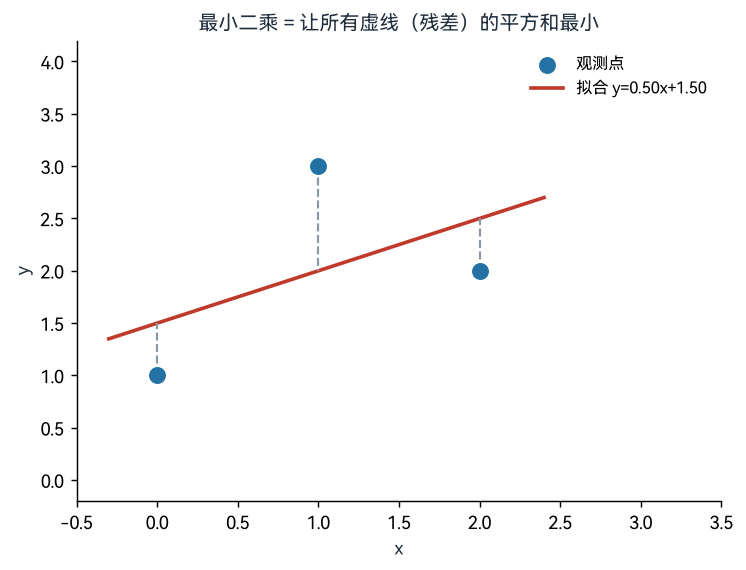
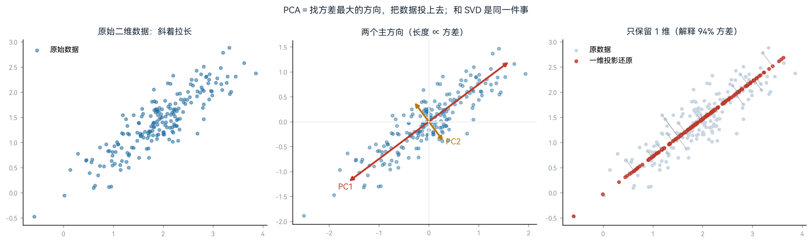
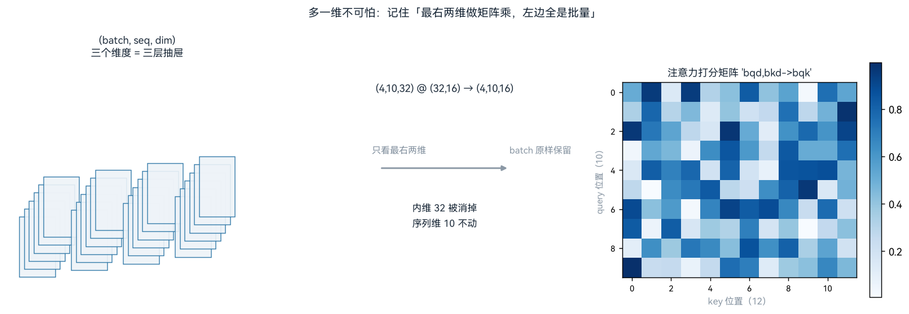

# 01 · 公式运算手册（每个公式都能拿笔算）

> 看懂符号 ≠ 会算。这里每个公式都给：**符号表 → 数字代入 → 分步计算 → 为什么 → 误区 → 一句话记忆**。
> 想自己跑一遍：`python formula_lab.py 3`（数字是编号）。

## F1 · 点积与余弦　`两个向量像不像`

**一句话**：先相乘、再相加，最后除以两个长度 —— 得到 −1 到 1 之间的相似度。

**符号表**

| 符号 | 含义 |
|---|---|
| `a·b` | 点积：对应项相乘再相加 |
| `|a|` | 长度：各分量平方和开根号 |
| `cosθ` | 余弦相似度：点积 ÷ 两个长度 |

**分步计算**

| 步骤 | 数字代入 | 结果 | 说明 |
|---|---|---|---|
| ① 逐项相乘 | `3×1 = 3` | **3** | a 的第 1 项 × b 的第 1 项 |
| ② 逐项相乘 | `4×2 = 8` | **8** | a 的第 2 项 × b 的第 2 项 |
| ③ 相加 | `3 + 8` | **11** | 这就是点积 a·b |
| ④ 算长度 | `√(3²+4²)` | **5.0** | 3-4-5 三角形 |
| ⑤ 算长度 | `√(1²+2²)` | **2.236** |  |
| ⑥ 相除 | `11 ÷ (5×2.236)` | **0.984** | 余弦相似度 |
| ⑦ 反算角度 | `arccos(0.984)` | **10.3°** | 两个向量夹角很小 = 很相似 |

**为什么是这样**

- 点积大 = 方向一致 = 相似；除以长度是为了排除「长的向量点积天然大」的干扰。
- 垂直时点积恰好为 0，所以「点积=0」可以直接当「不相关」用。
- 神经网络里 w·x 就是这个式子：w 是模板，x 是输入，结果就是匹配分数。

> ⚠️ **常见误区**：别把点积和余弦搞混：点积受长度影响，余弦不受。检索 embedding 用余弦，判断梯度方向用点积。

> 🔑 **一句话记忆**：乘、加、除长度。

---

## F2 · 矩阵乘法　`为什么是行乘列`

**一句话**：C 的第 i 行第 j 列 = A 的第 i 行 · B 的第 j 列（一次点积）。

**符号表**

| 符号 | 含义 |
|---|---|
| `A (m,k)` | m 行 k 列 |
| `B (k,n)` | k 行 n 列：k 必须等于 A 的列数 |
| `C (m,n)` | 结果：m 行 n 列 |

**分步计算**

| 步骤 | 数字代入 | 结果 | 说明 |
|---|---|---|---|
| C[1][1] | `1×7 + 2×9 + 3×11` | **58** | A 第 1 行 · B 第 1 列 |
| C[1][2] | `1×8 + 2×10 + 3×12` | **64** | A 第 1 行 · B 第 2 列 |
| C[2][1] | `4×7 + 5×9 + 6×11` | **139** | A 第 2 行 · B 第 1 列 |
| C[2][2] | `4×8 + 5×10 + 6×12` | **154** | A 第 2 行 · B 第 2 列 |

**为什么是这样**

- 每个结果格子 = 一行与一列的点积，所以中间维 k 必须相等（要能逐项配对）。
- 另一种看法：C 的每一行 = 把 B 的各行按 A 的系数加权相加 —— 这就是"线性组合"。
- 神经网络的一层（batch 个样本）就是把这件事并行做 batch 次。

> ⚠️ **常见误区**：最常见的错：把 A@B 写成 B@A。矩阵乘法不满足交换律，因为「先转再缩放」和「先缩放再转」结果不同。

> 🔑 **一句话记忆**：结果形状 = 去掉中间维： (m,k)@(k,n) → (m,n)。

---

## F3 · softmax　`三个分数变三个概率`

**一句话**：每个分数取 e 的幂，再除以它们的总和 —— 概率都为正、加起来正好 1。

**符号表**

| 符号 | 含义 |
|---|---|
| `z_i` | 原始分数 logits，可正可负 |
| `e^{z_i}` | 取指数：变成正数，并放大差距 |
| `Σe^{z_j}` | 所有指数之和，当作分母 |

**分步计算**

| 步骤 | 数字代入 | 结果 | 说明 |
|---|---|---|---|
| ① 取指数 | `e^2` | **7.389** | 最大的分数 → 最大的正数 |
| ② 取指数 | `e^1` | **2.718** |  |
| ③ 取指数 | `e^0` | **1.000** |  |
| ④ 相加 | `7.389+2.718+1.000` | **11.107** | 分母 |
| ⑤ 归一化 | `7.389 ÷ 11.107` | **0.665** | 类别 1 的概率 |
| ⑥ 归一化 | `2.718 ÷ 11.107` | **0.245** | 类别 2 |
| ⑦ 归一化 | `1.000 ÷ 11.107` | **0.090** | 类别 3（检查：三者相加=1） |

**为什么是这样**

- 用 e 的幂而不是直接归一化分数：因为分数可能是负数，e 保证恒正。
- 指数会放大差距：z 只差 2，概率就差了 7 倍多（0.665 vs 0.090）。
- 实现时先减去最大值再取指数，结果完全一样，但不会溢出（e^1000 = inf）。

> ⚠️ **常见误区**：别自己写 softmax 再做交叉熵还重复归一化；也别忘减最大值，分数一大就变 nan。

> 🔑 **一句话记忆**：指数 → 求和 → 相除。

---

## F4 · 交叉熵与梯度　`为什么导数就是 p − y`

**一句话**：loss = −ln(正确答案的概率)；对分数求导，结果惊人地简洁：p − y。

**符号表**

| 符号 | 含义 |
|---|---|
| `p` | 模型给每个类别的概率，比如 (0.1, 0.7, 0.2) |
| `y` | one-hot 标签，比如正确是第 2 类 → (0,1,0) |
| `p_c` | 正确类那一项的概率，这里 0.7 |

**分步计算**

| 步骤 | 数字代入 | 结果 | 说明 |
|---|---|---|---|
| ① 取正确类的概率 | `p[2]` | **0.70** | 只看正确答案那一项 |
| ② 取负对数 | `−ln(0.70)` | **0.357** | 这就是 loss |
| ③ 梯度 | `p − y` | **(0.1, −0.3, 0.2)** | 逐项相减 |
| ④ 解读 | `正确类 −0.3` | **→ 要增大** | 负梯度 = 往正方向调 |
| ⑤ 解读 | `错误类 +0.1` | **→ 要减小** | 正梯度 = 往负方向调 |

**为什么是这样**

- 为什么梯度这么简单：loss = −ln(p_c)，而 p_c = e^{z_c}/Σe^{z_j}，求导后交叉项全部抵消。
- 「p 越接近 1，梯度越接近 0」= 学得越好，改得越少，自动收敛。
- 错得越离谱（p_c 越小），梯度越大，修正越猛 —— 这正是我们想要的惩罚力度。

> ⚠️ **常见误区**：标签必须是 one-hot 或整数索引，不能是"差不多对"的软标签（除非你要做标签平滑）。

> 🔑 **一句话记忆**：loss 只看正确类；梯度 = 概率 − 标签。

---

## F5 · 反向传播　`把数字一路乘回去`

**一句话**：前向用矩阵乘算出预测；反向用「矩阵乘 + 转置」把梯度传回去，每一步只算一个局部导数。

**符号表**

| 符号 | 含义 |
|---|---|
| `z1 = x·W1 + b1` | 第一层线性输出 |
| `h = ReLU(z1)` | 激活：负数变 0 |
| `dp` | loss 对预测的梯度 |
| `dW = hᵀ·dp` | 权重的梯度：输入ᵀ × 上层梯度 |

**分步计算**

| 步骤 | 数字代入 | 结果 | 说明 |
|---|---|---|---|
| 前向 | `z1 = 1×(0.5,−1) + 2×(1,0.5)` | **(2.5, 0)** |  |
| 前向 | `h = ReLU(2.5, 0)` | **(2.5, 0)** |  |
| 前向 | `z2 = 2.5×2 + 0×(−1) + 0.1` | **5.1** | 预测值 |
| 损失 | `diff = 5.1 − 1` | **4.1** |  |
| 损失 | `loss = 4.1²` | **16.81** |  |
| 反向 | `dp = 2×4.1` | **8.2** | 局部导数 × 传回来的梯度 |
| 反向 | `dW2 = hᵀ·dp` | **(20.5, 0)** | 形状 (2,1)，和 W2 一致 |
| 反向 | `dh = dp·W2ᵀ` | **(16.4, −8.2)** | 把责任按权重比例分回去 |
| 反向 | `dh[z1≤0]=0` | **(16.4, 0)** | ReLU 砍掉的位置不传梯度 |
| 反向 | `dW1 = xᵀ·dh` | **(16.4,0, 32.8,0)** | 形状 (2,2)，和 W1 一致 |

**为什么是这样**

- 链式法则：dL/dW = (dL/d输出) × (d输出/dW)，一层层乘回去。
- 转置不是装饰：dp 的形状是「样本 × 输出」，要变成「输入 × 输出」的权重梯度，必须把输入放到行上。
- ReLU 的 mask 必须加：前向被砍成 0 的位置，反向梯度也必须是 0。

> ⚠️ **常见误区**：三个必错点：转置弄反（形状对、数值错）、漏掉 ReLU mask、忘了除以 batch 大小。用数值梯度校验 1 秒就能发现。

> 🔑 **一句话记忆**：dW = 输入ᵀ × 上层梯度（每个 dW 都和对应 W 同形状）。

---

## F6 · 特征值方程　`Av = λv 怎么解`

**一句话**：特征向量 v 是被 A 变换后方向不变的方向；λ 是沿这个方向的拉伸倍数。

**符号表**

| 符号 | 含义 |
|---|---|
| `A v = λ v` | 方向不变，只缩放 |
| `(A − λI) v = 0` | 把 λ 移到左边 |
| `det(A − λI) = 0` | v 非零 ⟹ 矩阵必须不可逆 |

**分步计算**

| 步骤 | 数字代入 | 结果 | 说明 |
|---|---|---|---|
| ① 移项 | `A − λI` | **[[1,1],[1,1]]（取 λ=1）** |  |
| ② 求行列式 | `(2−1)(2−1) − 1×1` | **0** | det = 0 → λ=1 是特征值 |
| ③ 解方程 | `(A−λI)v = 0` | **v = (−0.707, 0.707)** | 取一个非零解 |
| ④ 另一个 λ | `λ = 3` | **v = (0.707, 0.707)** |  |
| ⑤ 验证 | `A·v 与 λ·v` | **完全相等 ✅** | 这就是定义 |

**为什么是这样**

- 为什么用 det=0：v 不能是零向量，所以 (A−λI) 必须有非零解 → 必须不可逆 → det 为 0。
- 对称矩阵的特征向量互相垂直，所以 PCA 找到的主方向天然正交。
- λ 的大小 = 这个方向的重要程度（方差大小），这就是 PCA 排序的依据。

> ⚠️ **常见误区**：别把特征值和奇异值混了：特征值可能为负、可能没有实特征值；奇异值恒为正且总有。

> 🔑 **一句话记忆**：Av=λv → 移项 → det=0 → 解 v。

---

## F7 · SVD 与 k 秩近似　`为什么丢掉小奇异值不心疼`

**一句话**：任何矩阵 A = UΣVᵀ；只保留前 k 个奇异值，就得到「最像原矩阵」的 k 秩近似。

**符号表**

| 符号 | 含义 |
|---|---|
| `U` | 左奇异向量：输出方向的"基" |
| `Σ` | 奇异值对角阵：从大到小排列 |
| `Vᵀ` | 右奇异向量：输入方向的"基" |
| `σ_i` | 第 i 个奇异值，衡量这一层图案有多重要 |

**分步计算**

| 步骤 | 数字代入 | 结果 | 说明 |
|---|---|---|---|
| A 的尺寸 | `40 × 30` | **** | 原始需要存 1200 个数 |
| k=1 | `保留能量 10.3%` | **误差 89.7%** | 存 71 个数 |
| k=5 | `39.2%` | **64.3%** | 355 个数 |
| k=10 | `64.5%` | **42.0%** | 710 个数 |
| k=20 | `93.2%` | **11.5%** | 1420 个数（比原图还大） |
| k=30 | `100%` | **0%** | 2130 个数（完整存储） |

**为什么是这样**

- A 可以写成若干「图案层」相加：A = Σσᵢ·uᵢvᵢᵀ，σ 越大的层越是主要结构。
- 丢掉小的 σ = 丢掉细节/噪声，主结构几乎不变 —— 这就是图像压缩和 PCA 的原理。
- 但压缩不一定省空间：k 太大时，U/S/V 加起来的存储量可能超过原矩阵（见表格 k=20）。

> ⚠️ **常见误区**：别以为"SVD 一定压缩"：只有当矩阵很大、且奇异值衰减快时，低秩存储才划算。

> 🔑 **一句话记忆**：大 σ 留、小 σ 丢；k 越大越准、越占空间。

---

## F8 · 最小二乘　`无解时取最接近的解`

**一句话**：方程比未知数多时没有精确解，把 b 投影到 A 的列空间上，投影点就是最优拟合。

**符号表**

| 符号 | 含义 |
|---|---|
| `A (n,2)` | 设计矩阵：每行一个样本（x，1） |
| `b` | 目标值 |
| `AᵀA` | 正规方程的左边：(2,2) 方阵，可逆 |
| `残差` | b − Ax，必然垂直于列空间 |

**分步计算**

| 步骤 | 数字代入 | 结果 | 说明 |
|---|---|---|---|
| ① AᵀA | `[[5,3],[3,3]]` | **** | 2×2 方阵 |
| ② Aᵀb | `(7, 6)` | **** |  |
| ③ 求逆 | `(AᵀA)⁻¹` | **[[0.5,−0.5],[−0.5,0.833]]** |  |
| ④ 相乘 | `(AᵀA)⁻¹Aᵀb` | **(0.5, 1.5)** | → y = 0.5x + 1.5 |
| ⑤ 预测 | `Ax` | **(1.5, 2, 2.5)** | 拟合直线上的点 |
| ⑥ 残差 | `b − Ax` | **(−0.5, 1, −0.5)** |  |
| ⑦ 平方和 | `Σ残差²` | **1.5** | 最小二乘的目标值 |

**为什么是这样**

- 为什么能这样解：要求残差最小，最优时残差必然垂直于 A 的每一列 → Aᵀ(b−Ax)=0 → AᵀAx=Aᵀb。
- 这就是线性回归的闭式解；加 sigmoid 变成逻辑回归（没有闭式解，只能梯度下降）。
- 神经网络 = 把这个"线性拟合"换成多层非线性，目标仍是让残差（loss）最小。

> ⚠️ **常见误区**：AᵀA 奇异（列线性相关）时不能求逆，要用伪逆 np.linalg.pinv 或 lstsq。

> 🔑 **一句话记忆**：投影 → 残差垂直 → 正规方程。

---

## F9 · PCA 五步　`每一步的数字`

**一句话**：中心化 → 算协方差 → 求最大特征方向 → 投影 → 看解释方差比。

**符号表**

| 符号 | 含义 |
|---|---|
| `μ` | 均值向量 |
| `Xc` | 中心化后的数据 X − μ |
| `C = XcᵀXc/(n−1)` | 协方差矩阵 |
| `λ₁/Σλ` | 第一主成分解释的方差比例 |

**分步计算**

| 步骤 | 数字代入 | 结果 | 说明 |
|---|---|---|---|
| ① 均值 | `μ` | **(4.473, 1.960)** | 5 个点的平均 |
| ② 中心化 | `Xc = X − μ` | **均值变 (0,0)** |  |
| ③ 协方差 | `C` | **[[20.74,−4.68],[−4.68,2.88]]** |  |
| ④ 特征值 | `λ` | **(21.90, 1.72)** | 方差大小 |
| ⑤ 主方向 | `v1` | **(−0.971, 0.239)** | 第一主成分 |
| ⑥ 解释比 | `λ₁/Σλ` | **92.70%** | 一维就够描述 |
| ⑦ 投影 | `z = Xc·v1` | **5 个数** | 二维 → 一维 |
| ⑧ 还原 | `z·v1ᵀ + μ` | **回到二维** |  |
| ⑨ 误差 | `平均重建误差` | **0.8595** | 丢掉的 7.3% 信息 |

**为什么是这样**

- 必须先中心化：否则第一主方向会被"均值偏移"带偏，指向数据中心而不是变化方向。
- 特征值就是各方向的方差，λ₁/Σλ 直接告诉你"压到一维会丢多少"。
- 协方差矩阵的特征分解 ≡ 对数据矩阵做 SVD，两种算法结果一致。

> ⚠️ **常见误区**：降维前不中心化是最常见的错误；另外别忘了按特征值从大到小排序。

> 🔑 **一句话记忆**：减均值、求方向、投上去、看比例。

---

## F10 · einsum 字母规则　`三句话看懂批量运算`

**一句话**：字母表示维度；出现在输出就保留，不出现就沿它求和。

**符号表**

| 符号 | 含义 |
|---|---|
| `b` | batch：一批样本 |
| `q / k` | query 位置 / key 位置 |
| `d` | 特征维（点积时被求和掉） |

**分步计算**

| 步骤 | 数字代入 | 结果 | 说明 |
|---|---|---|---|
| 'ik,kj->ij' | `普通矩阵乘` | **(2,3)@(3,4)→(2,4)** | k 被求和 |
| 'bik,kj->bij' | `批量矩阵乘` | **(2,3,4)@(4,5)→(2,3,5)** | b 保留，k 求和 |
| 'bqd,bkd->bqk' | `注意力打分 QKᵀ` | **(2,3,4),(2,5,4)→(2,3,5)** | d 求和 = 点积 |

**为什么是这样**

- 两边都出现的字母 = 要相乘并求和的维度（就是内积）。
- 只在输出里的字母 = 新的结果维度，按输出顺序摆放。
- 注意力公式 softmax(QKᵀ/√d)·V 用 einsum 写就是三行，形状一目了然。

> ⚠️ **常见误区**：字母别重名（同一字母必须代表同一维）；输出的字母顺序决定结果轴顺序。

> 🔑 **一句话记忆**：共有 → 求和；独有 → 新轴。

---
