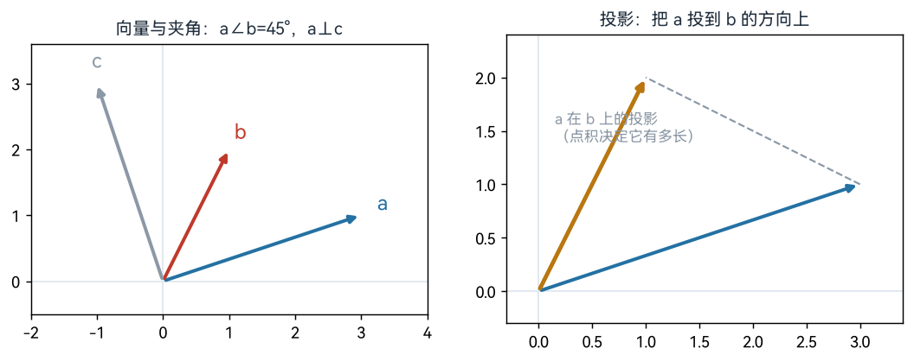
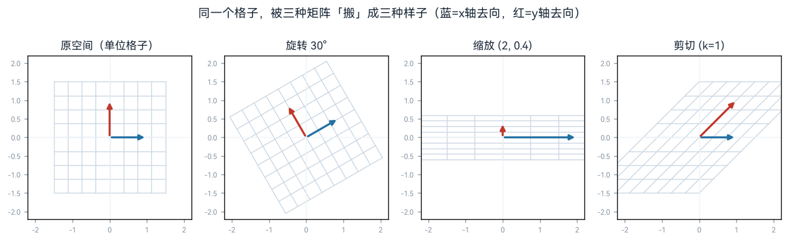
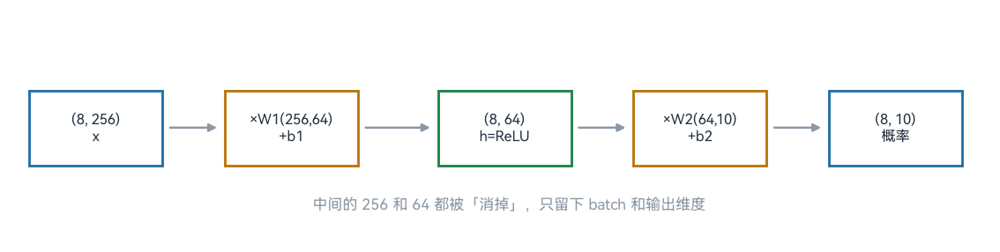
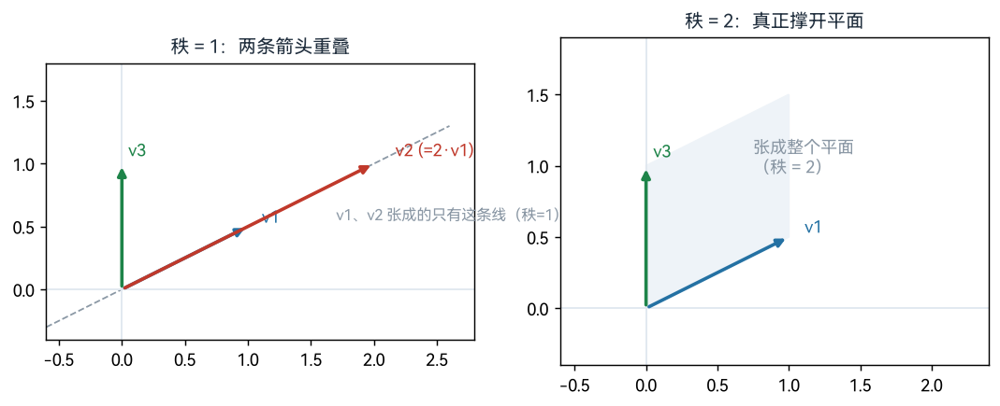
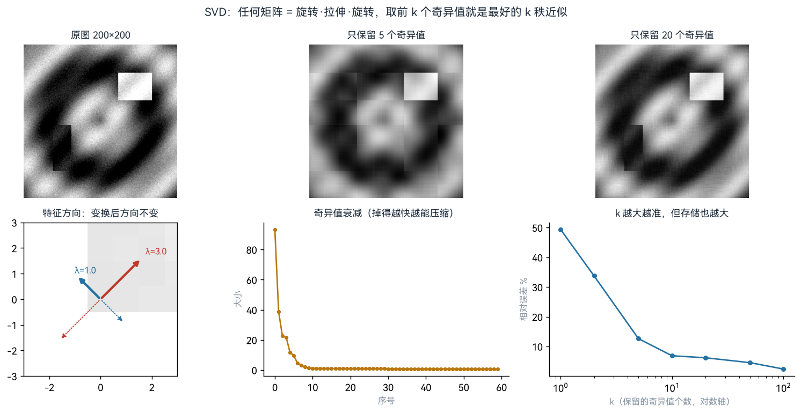
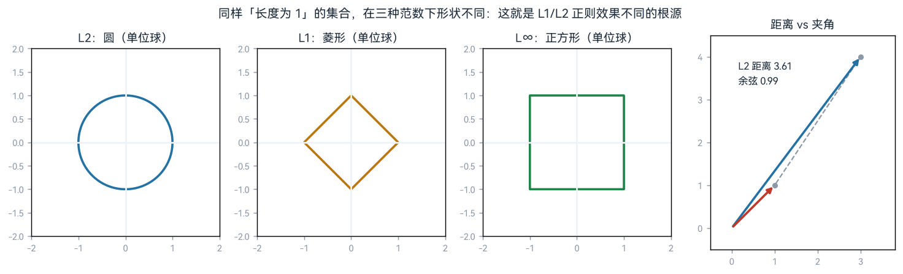
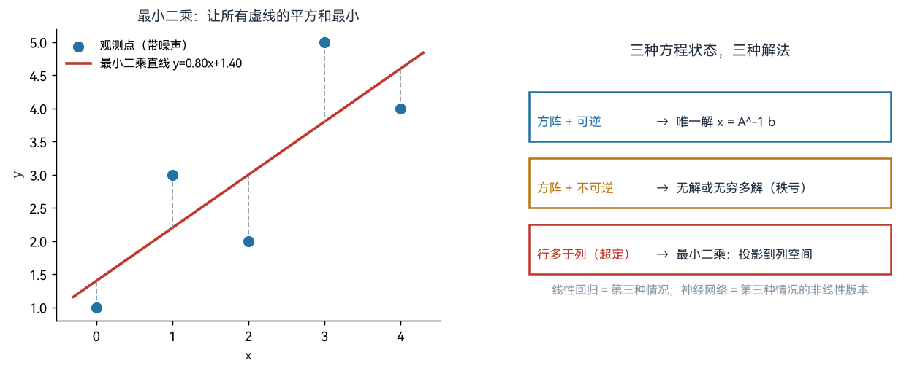
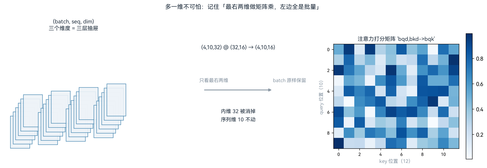
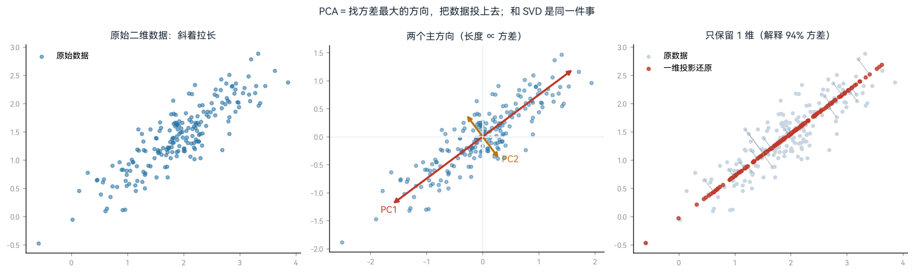

# 01 · 线性代数（由简入深 · 10 课）

> 目标：**能用线性代数读懂神经网络的每一行代码**，不是学完一本线代教材。
> 结构：入门 3 课 → 进阶 4 课 → 深入 3 课。每课 5~10 分钟，跑完就有图。

## 先看这个

📱 **手机上看（唯一入口）**：打开 `chapter1.html` —— 每节课里直接嵌着这节的公式拆解（10 课 · 15 个公式 · 18 张图，单文件离线可看）

- **理论主线**：`THEORY.md`（10 节，每节：一句话结论 → 图 → 公式 → 直觉 → 在 AI 里的位置 → 自检）
- **动手实验**：本目录的 10 个 `*.py`
- **练习题**：`exercises.md`（18 题，纸笔做）
- **自测**：`check.py`（14 道随机题，≥12 分过关）
- **公式手册**：`FORMULAS.md` + `formula_lab.py` + `formulas-mobile.html`（10 个公式逐符号、逐数字拆解）

## 10 课地图

### 入门：先建立直觉

| 课 | 文件 | 一句话 | 图 |
|---|---|---|---|
| L1 | `01_vectors.py` | 点积 = 相似度 | `figures/01_vectors.png` |
| L2 | `02_matrix_transform.py` | 矩阵 = 空间变换，列 = 坐标轴去哪了 | `figures/02_matrix_transform.png` |
| L3 | `03_shapes.py` | `(n,k)@(k,m)→(n,m)`，内维消掉 | `figures/03_shapes.png` |

### 进阶：能算、能判断

| 课 | 文件 | 一句话 | 图 |
|---|---|---|---|
| L4 | `04_rank_span.py` | 秩 = 有效维度，降维有无损看它 | `figures/04_rank_span.png` |
| L5 | `05_eigen_svd.py` | 特征值 = 拉伸倍数；SVD = 最好的 k 秩近似 | `figures/05_eigen_svd.png` |
| L6 | `06_apply_nn.py` | W 的每一列就是一个模板 | `figures/06_apply_nn.png` |
| L7 | `07_norms_distance.py` | L1/L2/余弦：三种"多远"，决定正则效果 | `figures/07_norms.png` |

### 深入：工程与高维

| 课 | 文件 | 一句话 | 图 |
|---|---|---|---|
| L8 | `08_inverse_lstsq.py` | 无解时取最接近解 = 最小二乘 = 线性回归 | `figures/08_lstsq.png` |
| L9 | `09_batch_einsum.py` | 最右两维做矩阵乘，左边全是批量 | `figures/09_einsum.png` |
| L10 | `10_pca.py` | PCA = 沿方差最大方向投影（就是 SVD） | `figures/10_pca.png` |

> L1：点积为 0 = 垂直 = 毫无相似；越大越像。神经元打分就是这件事。

> L2：同一张格子被三种矩阵搬成三种样子。**看矩阵的列，就知道空间怎么变。**

> L3：中间的 256 和 64 被"消掉"，只留 batch 和输出维。

> L4：秩=1 时两条箭头重叠；秩=2 才真正撑开平面。

> L5：只留 5 个奇异值就有 63.8% 的能量，20 个已经很清晰。

> L7：单位球在三种范数下是圆/菱形/正方形 —— 这就是 L2 平滑、L1 稀疏的几何原因。

> L8：5 个点拟合直线 = 解一个无解的方程组，取投影（最小二乘）。

> L9：`(4,10,32)@(32,16)` 内维 32 被消掉，batch 和序列维不动。

> L10：PCA 把斜着的一团点投到主方向上，用 1 维解释 94% 的方差。

## 怎么学（60 分钟一轮）

| 步骤 | 做什么 | 时长 |
|---|---|---|
| 1 | 读 `THEORY.md` 第 1~2 节 | 8 min |
| 2 | 跑 `01`、`02`，各改一处参数看变化 | 12 min |
| 3 | 读第 3~5 节，跑 `03`、`04`、`05` | 15 min |
| 4 | 读第 6~9 节，跑 `06`~`10` | 20 min |
| 5 | 做 `exercises.md` + `check.py` | 15 min |

## 过关标准

`python check.py` **≥ 12/14**，并且能不看资料回答：

1. `(8,256)@(256,64)` 的输出形状？
2. 点积为 0 在图像识别里意味着什么？
3. 为什么矩阵乘法不能交换顺序？
4. 三个共面向量组成的矩阵，秩最大是几？
5. `dW = xᵀ·dh` 里的转置为什么必须存在？
6. L1 正则为什么比 L2 更容易产生 0 权重？
7. 5×2 的矩阵为什么不能求逆？该用什么方法？
8. `'bqd,bkd->bqk'` 里 d 去哪了？

## 常见坑

| 坑 | 正确做法 |
|---|---|
| 把矩阵当"数字表格"背 | 记成"动作"：它把空间怎么搬 |
| 以为 `A@B = B@A` | 顺序有几何含义，转了再缩放 ≠ 缩放再转 |
| 写代码不先看形状 | 先在纸上写 `(n,k)@(k,m)→(n,m)` |
| 觉得特征值没用 | 它是变换最本质的方向，PCA/LoRA 全靠它 |
| 区分不了 L1/L2 | 想单位球形状：菱形 → 稀疏；圆 → 平滑 |
| 用欧氏距离做检索 | 文本/图像 embedding 用**余弦**，别被长度干扰 |

## 目录内其它文件

| 文件 | 作用 |
|---|---|
| `_plot.py` | 公共绘图设置（中文字体、配色、保存） |
| `THEORY.md` | 图文理论主线（10 节） |
| `exercises.md` | 18 道手算题（含答案） |
| `check.py` | 14 道随机自测题 |
| `FORMULAS.md` | 公式运算手册：符号表 → 数字代入 → 分步计算 → 为什么 → 误区 |
| `formula_lab.py` | 可运行的公式实验室（`python formula_lab.py 3` 只看 softmax） |
| `chapter1.html` | **总文档**：10 节课，每节内含对应公式拆解（共 15 个公式） |
| `figures/` | 10 张实验图 + 6 张公式示意图（F1~F8） |

## 和下一个单元的衔接

`02-calculus` 会直接用到这里的两样东西：**转置**（`dW = xᵀ·dh`）和**点积**（梯度方向）。
`05-neural-net` 则是 `ai-from-scratch` 工程的完整版：一层网络 = 一次矩阵乘法 + 非线性。
