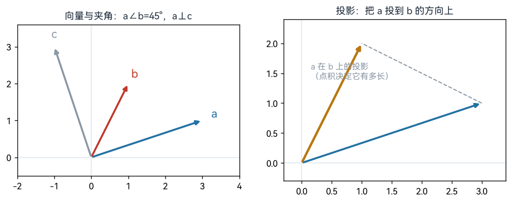
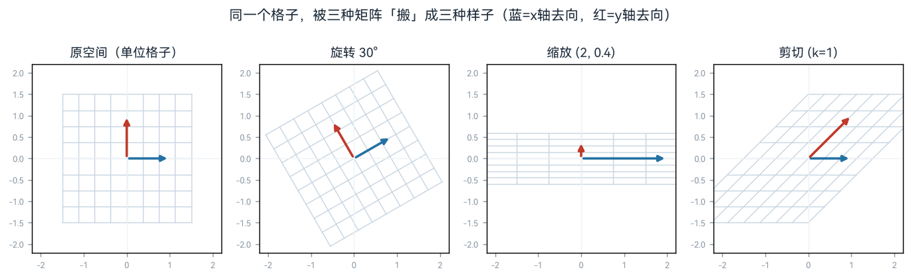
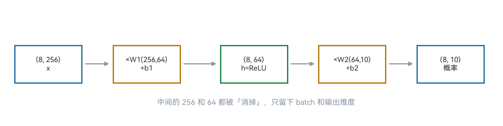
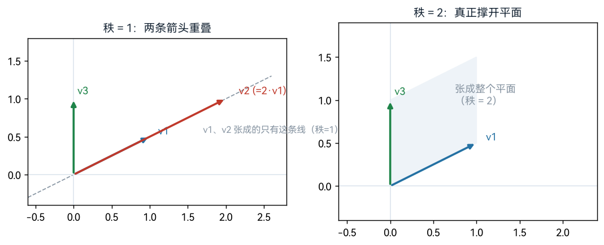
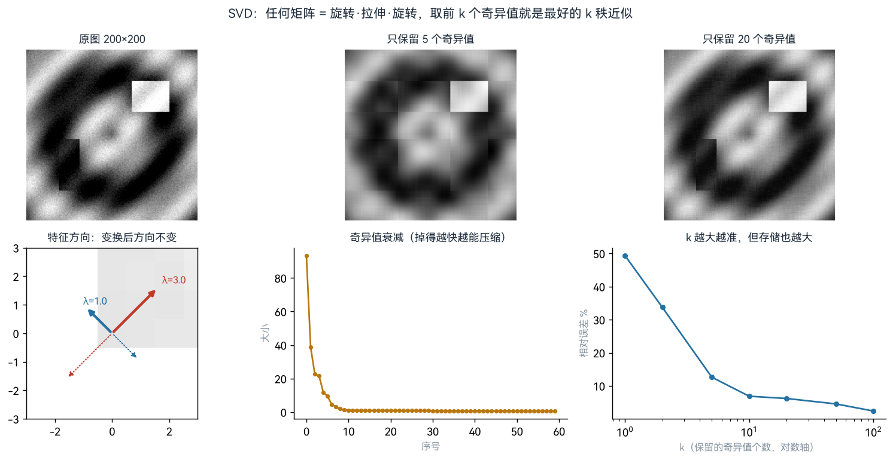
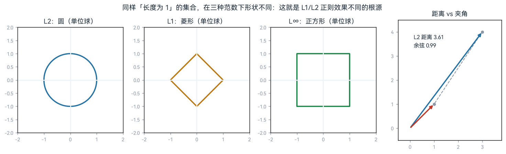
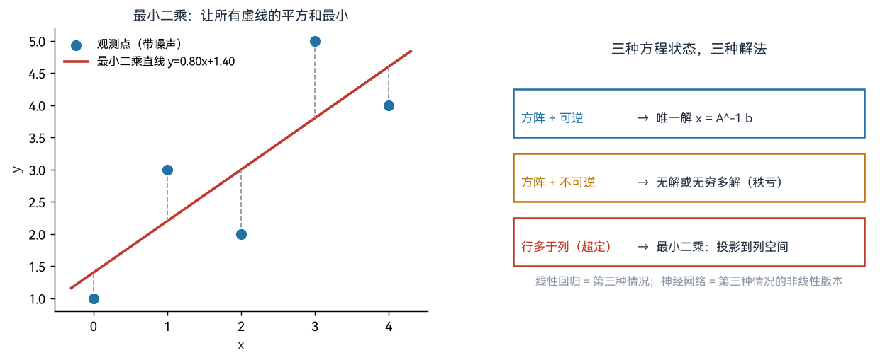
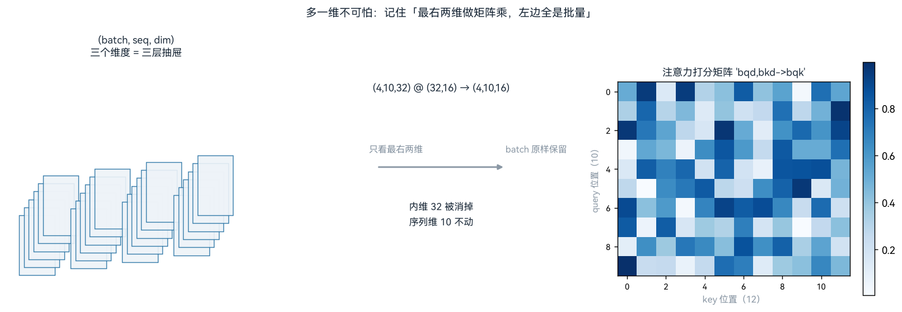
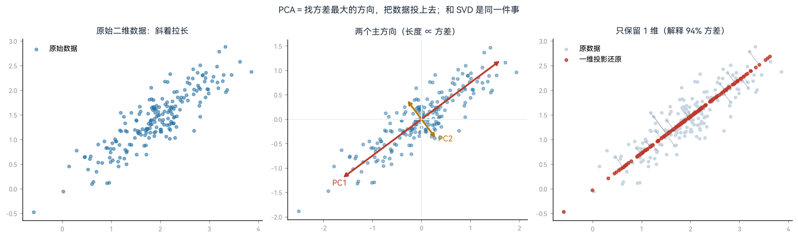
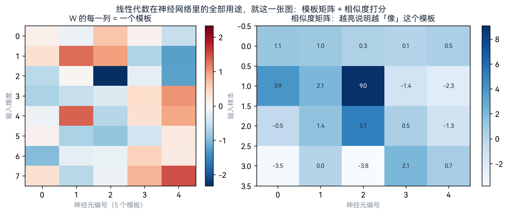

# 01 线性代数 · 图文理论（由简入深）

> 这份文档是**理论主线**，配套的 10 个 `*.py` 是**实验**。
> 建议顺序：先读一节 → 跑对应脚本改两行 → 回来做自检题。
> 每节固定结构：**一句话结论 → 图 → 公式 → 直觉 → 在 AI 里的位置 → 自检**。

---

## 第 1 节 · 向量与点积：相似度的来源

**一句话**：向量是一串数，也是空间里的一支箭头；点积衡量两支箭头"同方向的程度"。



**公式**

```
点积      a·b = Σ aᵢbᵢ          （逐项相乘再相加）
长度      |a| = √(a·a)
余弦相似  cosθ = a·b / (|a||b|)  ∈ [-1, 1]
投影长度  a 在 b 方向上的分量 = (a·b) / |b|
```

**直觉**：
- 方向完全一致 → 点积 = 两长度的乘积（cos=1）
- 垂直 → 点积 = 0（"毫无相似"）
- 反向 → 点积为负

**在 AI 里的位置**：
- 神经元的加权和 `w·x`，就是"输入和权重有多像"
- 注意力 `Q·Kᵀ` 就是批量点积，算"这个词该关注那个词多少"
- 向量检索（RAG）用余弦找最相近的文档块

**自检**：`(2,1)·(1,3)` 是多少？为什么 `a·c=0` 就说明垂直？

---

## 第 2 节 · 矩阵是变换，不是表格

**一句话**：矩阵把整个空间"搬"一次；它的**每一列 = 原来那根坐标轴被搬到了哪里**。



**公式 / 事实**

```
单位矩阵 I = [[1,0],[0,1]]   →  空间不动（列就是 (1,0)、(0,1)）
旋转 30°   = [[cos,-sin],[sin,cos]]
缩放       = [[sx,0],[0,sy]]      面积倍数 = |det| = sx·sy
剪切       = [[1,k],[0,1]]        det = 1（面积不变，形状被推斜）
```

**直觉**：不要背矩阵，**看它的列**。列就是"新坐标轴"。
`A @ x` 的含义是："按 A 指定的方式搬动空间，然后看 x 落到哪"。所以矩阵乘 **不满足交换律** —— 先转再缩放 ≠ 先缩放再转。

**在 AI 里的位置**：一层网络 `h = x@W + b` 就是一次高维空间的线性变换（256 维 → 64 维）。所谓"学习"，就是找一组好用的 `W`。

**自检**：`[[0,-1],[1,0]]` 把 `(1,0)` 搬到哪？`det` 为 0 意味着什么？

---

## 第 3 节 · 形状规则：90% 的报错出在这里

**一句话**：`(n,k) @ (k,m) → (n,m)`，中间的 `k` 必须相等并被"消掉"。



**公式**

```
        内维必须相等
             ↓
(n, k)  @  (k, m)   →   (n, m)
 ↑                         ↑
样本数/批量            输出特征数
```

**直觉**：把形状写成链式，一眼看出结果：

```
(8, 256) × (256, 64) → (8, 64) × (64, 10) → (8, 10)
        ↑ 消掉 256            ↑ 消掉 64
```

**在 AI 里的位置**：`step2_forward` 的四行代码就是这条规则；一旦写错 batch 维或忘了转置，报错信息都指向这里。

**自检**：`(16,256)@(256,64)`？`(2,3)@(2,3)` 能乘吗？

---

## 第 4 节 · 秩：能不能无损降维

**一句话**：秩 = **独立方向的数量** = 数据真正的"有效维度"。



**公式 / 判据**

```
两个向量共线     → 秩 = 1，det = 0（空间被压成一条线）
三个向量共面     → 秩 = 2
秩 < 维数        → 存在冗余，可以压缩而不丢信息
```

**直觉**：`v2 = 2·v1` 时，v2 没有带来任何新方向。你给它两个坐标，其实只有一个自由度。

**在 AI 里的位置**：
- 瓶颈层（256→32）是"主动降秩"，逼模型只保留最重要的信息
- 注意力矩阵若接近低秩，说明它在"平均化"，失去了分辨力
- LoRA 微调 = 假设权重更新是低秩的

**自检**：`(1,0,0)`、`(0,1,0)`、`(1,1,0)` 的秩？

---

## 第 5 节 · 特征值与 SVD：矩阵的骨架

**一句话**：特征向量是"变换后方向不变"的方向；SVD 说任何矩阵 = 旋转·拉伸·旋转。



**公式**

```
特征分解   A v = λ v        v 方向不变，只被拉伸 λ 倍
SVD        A = U Σ Vᵀ       Σ 里是从大到小的"拉伸倍数"
k 秩近似   A_k = U_k Σ_k V_kᵀ   丢掉小的奇异值 = 丢掉细节
```

**直觉**：
- 特征值 = 各个方向被拉伸多少；最大特征值的方向就是数据最"长"的方向
- SVD 的奇异值掉得越快，说明信息越集中在少数几个方向 → 越能压缩

**实验现象（本工程实测）**：一张 200×200 的图，只保留 **5 个奇异值** 就有原图 63.8% 的能量，轮廓已经能看出来；保留 20 个就相当清楚。

**在 AI 里的位置**：PCA 降维、图像/模型压缩、LoRA、推荐系统的隐向量，全都建立在这上面。

**自检**：`[[3,0],[0,1]]` 的特征值和特征向量？k 越大重建误差怎么变？

---

## 第 6 节 · 范数与距离：三种"有多远"

**一句话**：同一个向量有三种长度，同一个距离有三种量法，**选哪种决定了正则化的效果**。



**公式**

```
L2（欧氏）    ||x||₂ = √Σxᵢ²        单位球 = 圆
L1（曼哈顿）  ||x||₁ = Σ|xᵢ|         单位球 = 菱形 → 顶点在坐标轴上
L∞（最大）    ||x||∞ = max|xᵢ|       单位球 = 正方形
余弦相似      cos = x·y / (||x||·||y||)   只看方向
```

**直觉**：
- L2 关心"整体大小"，所以 L2 正则让权重整体变小、更平滑
- L1 的可行域是菱形、顶点在轴上 → 最优点常落在顶点 → **很多权重恰好为 0**（稀疏、可剪枝）
- 余弦不看长度：`u` 和 `2u` 的欧氏距离很大，但余弦 = 1

**在 AI 里的位置**：权重衰减（L2）、稀疏化/剪枝（L1）、梯度裁剪（L2 范数）、embedding 检索（余弦）。

**自检**：`(3,4)` 的 L1/L2/L∞ 各是多少？为什么检索用余弦而不是欧氏距离？

---

## 第 7 节 · 逆矩阵与最小二乘：线性回归的真相

**一句话**：方程比未知数多时没有精确解，我们要的是"最接近"的解 —— 这就是拟合。



**公式**

```
方阵可逆     x = A⁻¹ b
超定方程     min ||Ax − b||²     最小二乘
闭式解       x = (AᵀA)⁻¹ Aᵀ b     （正规方程）
```

**直觉**：把 `b` 投影到 `A` 的列空间上（投影 = 第 1 节学的东西），残差就是"投影不到的那部分"。所以拟合直线 = 解一个无解的方程组，取投影。

**在 AI 里的位置**：线性回归就是最小二乘；加 sigmoid → 逻辑回归；再把线性层堆起来加激活 → 神经网络。**训练神经网络本质上也是"最小化误差"，只是没有闭式解，只能靠梯度下降逼近**。

**自检**：为什么 5×2 的矩阵不能求逆？`(AᵀA)⁻¹Aᵀy` 和 `np.linalg.lstsq` 为什么结果一样？

---

## 第 8 节 · 批量矩阵乘、广播与 einsum

**一句话**：真实模型里没有"一个向量乘一个矩阵"，全是多一维的批量运算；记住 **最右两维做矩阵乘，左边全是批量**。



**公式 / 规则**

```
(batch, 特征) @ (特征, 输出) → (batch, 输出)
(batch, seq, dim) @ (dim, out) → (batch, seq, out)      @ 只看最右两维
广播：(8,64) + (64,)  ✅      (8,64) + (8,)  ❌（从右对齐）
einsum：'bqd,bkd->bqk'   d 在两个输入都出现、输出没有 → 沿 d 求和
```

**直觉**：`einsum` 就是把形状写成字母的"乘法口诀"，**字母出现在输出就保留，不出现就求和**。注意力打分 `QKᵀ` 就是这一句话。

**在 AI 里的位置**：所有框架的底层运算；看懂 einsum，Transformer 的公式就不再是天书。

**自检**：`(4,10,32)@(32,16)` 结果形状？`'bqd,bkd->bqk'` 里 d 去哪了？

---

## 第 9 节 · PCA：沿着"最不丢信息"的方向降维

**一句话**：PCA = 中心化 → 找方差最大的方向 → 投影过去 → 用更少维度表示。



**步骤（实测数据）**

```
1. 中心化：减去均值，让数据以原点为中心
2. 求协方差矩阵 C = XᵀX/(n-1)
3. 取最大特征值对应的方向（等价于对 X 做 SVD 的第一行 Vᵀ）
4. 投影：z = X·v₁  —— 从二维变一维
5. 解释方差比 = λ₁ / Σλ
```

**实测结果**：200 个二维点，第一主成分解释 **94.1%** 的方差；投影到一维后平均重建误差 0.182，而随便投到 x 轴的误差是 0.462 —— 差 2.5 倍。

**在 AI 里的位置**：高维特征降到 2 维做可视化、去冗余加速训练、LoRA 的低秩假设。

**自检**：PCA 为什么必须先中心化？"解释 90% 方差"意味着丢掉多少信息？

---

## 第 10 节 · 汇总：一张图看懂这些概念怎么接上神经网络



| 概念 | 在神经网络里的化身 |
|---|---|
| 点积（第 1 节） | 一个神经元的输出 `w·x` |
| 矩阵变换（第 2 节） | 一层网络 `h = xW + b` |
| 形状规则（第 3 节） | `(batch,256)→(batch,64)→(batch,10)` |
| 秩（第 4 节） | 瓶颈层、低秩分解、注意力退化 |
| 特征值/SVD（第 5 节） | 权重初始化尺度、LoRA、PCA 可视化 |
| 范数（第 6 节） | L2 正则 / 梯度裁剪 / 余弦检索 |
| 最小二乘（第 7 节） | 损失函数 + 拟合的几何含义 |
| 批量与 einsum（第 8 节） | 注意力 `QKᵀ`、多头、batch 维 |
| PCA（第 9 节） | 特征降维、embedding 分析 |

**一句话总收尾**：神经网络的每一层都是"矩阵变换 + 非线性"，损失是"距离"，训练是"找到让距离最小的那组矩阵"。
**线性代数教你的，就是怎么描述和计算这些矩阵。**

---

## 学习路径建议

```
L1 向量 ──► L2 变换 ──► L3 形状 ──► L4 秩 ──► L5 特征/SVD ──► L6 回到神经网络
                                                        │
                              L7 范数 ◄─────────────────┘
                                 │
                              L8 最小二乘 ──► L9 批量/einsum ──► L10 PCA
```

前 6 节建立直觉，后 4 节是工程能力。**如果时间紧，至少把 L1、L3、L5、L6 吃透**，这四节覆盖了 90% 的实际使用。
