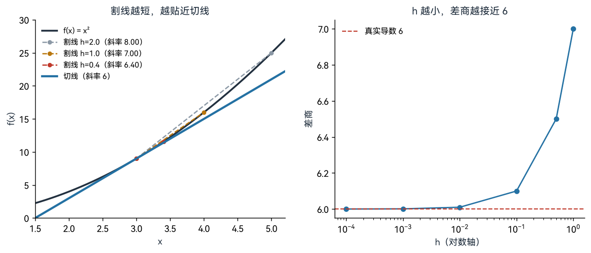
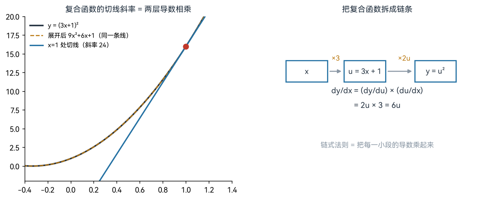
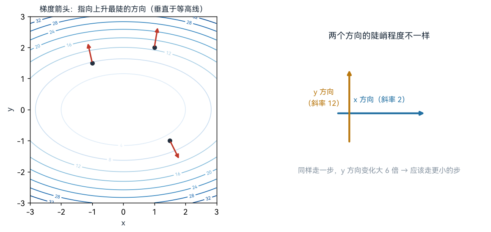
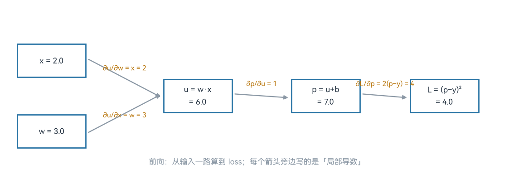
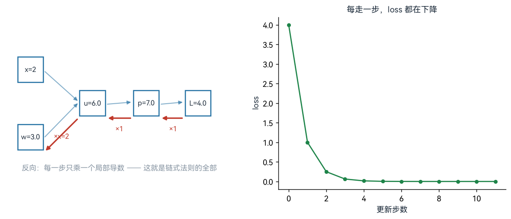
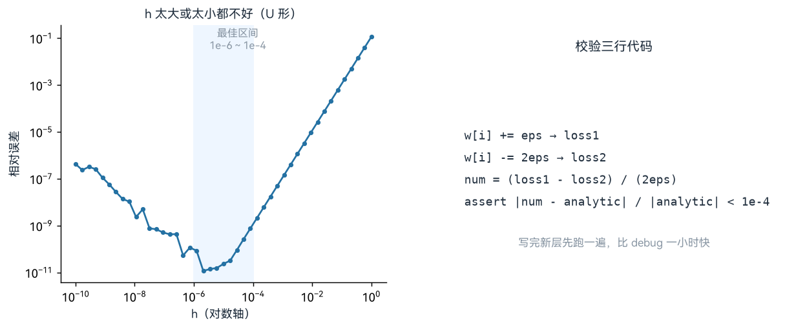
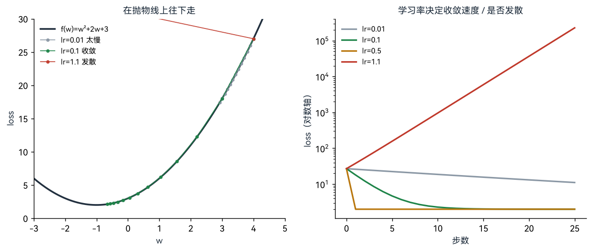

# 02 · 公式运算手册（微积分）

> 每个公式：**符号表 → 数字代入 → 分步计算 → 为什么 → 误区 → 一句话记忆**。
> 想自己跑：`python 01_derivative.py`（编号对应课程）。

## F1 · 导数的定义　`割线 → 切线`

**一句话**：导数是「这一点上的瞬时变化率」= 切线斜率 = 差商在 h→0 时的极限。

**符号表**

| 符号 | 含义 |
|---|---|
| `f(x)` | 函数（比如 x²） |
| `h` | 两点之间的距离 |
| `[f(x+h)−f(x)]/h` | 平均变化率 = 割线斜率 |
| `f'(x)` | 导数 = 切线斜率 |

**分步计算**

| 步骤 | 数字代入 | 结果 | 说明 |
|---|---|---|---|
| ① h=1 | `(4²−3²)/1` | **7.000** | 割线很斜 |
| ② h=0.5 | `(3.5²−3²)/0.5` | **6.500** |  |
| ③ h=0.1 | `(3.1²−3²)/0.1` | **6.100** |  |
| ④ h=0.001 | `` | **6.001** | 已经很接近 |
| ⑤ 极限 | `h→0` | **6** | f'(3)=2x|₃=6 |

**为什么是这样**

- h 越小，割线越贴近曲线，最终变成切线。
- 「瞬时」的严格含义就是极限：不是某一个小 h，而是 h 趋于 0 的趋势。
- 导数告诉参数「往哪边调、调多少」，这是所有训练算法的起点。

> ⚠️ **常见误区**：h 不能真的取 0（0/0 没意义）；数值计算时 h 太小反而误差大（见 F6）。

> 🔑 **一句话记忆**：割线越短越像切线，极限就是导数。

---

## F2 · 幂法则与链式法则　`复合函数一层层乘`

**一句话**：(xⁿ)' = n·xⁿ⁻¹；复合函数要「外层导数 × 内层导数」。

**符号表**

| 符号 | 含义 |
|---|---|
| `xⁿ` | 幂函数 |
| `u = g(x)` | 内层函数 |
| `y = f(u)` | 外层函数 |
| `dy/dx` | = (dy/du) × (du/dx) |

**分步计算**

| 步骤 | 数字代入 | 结果 | 说明 |
|---|---|---|---|
| ① 幂法则 | `(x³)' = 3x²` | **x=2 → 12** |  |
| ② 设内层 | `u = 3x+1` | **x=1 → u=4** |  |
| ③ 外层导数 | `dy/du = 2u` | **8** | 2×4 |
| ④ 内层导数 | `du/dx = 3` | **3** |  |
| ⑤ 相乘 | `8 × 3` | **24** | 验证：展开后 18x+6=24 ✓ |

**为什么是这样**

- 链式法则就是「换挡」：先对外层变量求导，再乘内层对内层的导数。
- 神经网络 loss 是复合函数，W 在最里层，所以必须一层层乘回去。
- 任何多层的反向传播，本质都是把这条规则重复用 N 次。

> ⚠️ **常见误区**：最常见错误：只算了外层，忘了乘内层的导数（漏掉那个 ×3）。

> 🔑 **一句话记忆**：外层求导，再乘内层。

---

## F3 · 偏导与梯度　`多维时往哪走最陡`

**一句话**：偏导 = 只对一个变量求导（其他当常数）；梯度 = 所有偏导排成向量 = 最陡上升方向。

**符号表**

| 符号 | 含义 |
|---|---|
| `∂f/∂x` | 把 y 当常数，对 x 求导 |
| `∇f` | 梯度向量 (∂f/∂x, ∂f/∂y) |
| `‖∇f‖` | 梯度的长度 = 有多陡 |

**分步计算**

| 步骤 | 数字代入 | 结果 | 说明 |
|---|---|---|---|
| ① 对 x 求偏导 | `∂/∂x (x²+3y²) = 2x` | **在(1,2) → 2** |  |
| ② 对 y 求偏导 | `∂/∂y (x²+3y²) = 6y` | **在(1,2) → 12** |  |
| ③ 拼成梯度 | `∇f = (2, 12)` | **** |  |
| ④ 长度 | `√(2²+12²)` | **12.17** | y 方向更陡 |
| ⑤ 数值验证 | `[f(1+h,2)−f(1−h,2)]/2h` | **2.000000** | 与解析一致 ✓ |

**为什么是这样**

- 梯度垂直于等高线，指向上升最快的方向；下降要走 −∇f。
- 各分量大小不同 → 各方向「陡峭程度」不同 → 这就是需要自适应学习率的原因。
- 万维参数时梯度就是万维向量，但每一维的计算方式完全相同。

> ⚠️ **常见误区**：求 ∂f/∂x 时忘记把 y 当常数（把它也求导了）。

> 🔑 **一句话记忆**：偏导 = 只动一个；梯度 = 全排成向量。

---

## F4 · 计算图与前向　`把复合函数拆成小步`

**一句话**：把 loss 拆成一串简单节点，每个节点只需要记住两件事：它的值、它的局部导数。

**符号表**

| 符号 | 含义 |
|---|---|
| `u = w·x` | 乘法节点：局部导数 ∂u/∂w = x |
| `p = u+b` | 加法节点：局部导数都是 1 |
| `L = (p−y)²` | 平方节点：局部导数 2(p−y) |

**分步计算**

| 步骤 | 数字代入 | 结果 | 说明 |
|---|---|---|---|
| ① 乘法 | `u = 3×2` | **6** | ∂u/∂w = 2 |
| ② 加法 | `p = 6+1` | **7** | ∂p/∂u = 1 |
| ③ 平方 | `L = (7−5)²` | **4** | ∂L/∂p = 4 |

**为什么是这样**

- 拆开之后每个局部导数都极其简单（乘法→乘、加法→1、平方→2x）。
- 前向时顺便把中间值存下来，反向时直接用（不用重算）。
- PyTorch 的 autograd 就是自动维护这样一张图。

> ⚠️ **常见误区**：忘了保存中间值：反向要用前向的 x、p 等，丢了就得重算。

> 🔑 **一句话记忆**：每个节点只记两个数：值 + 局部导数。

---

## F5 · 反向传播　`把梯度乘回去`

**一句话**：dL/d(某个输入) = 上游传回来的梯度 × 这个节点的局部导数；从 loss 往输入一路乘。

**符号表**

| 符号 | 含义 |
|---|---|
| `dL/dp` | 从 loss 传回 p 的梯度 |
| `dL/dw` | 我们最终要的 |
| `链式` | dL/dw = dL/dp × ∂p/∂u × ∂u/∂w |

**分步计算**

| 步骤 | 数字代入 | 结果 | 说明 |
|---|---|---|---|
| ① 起点 | `dL/dp = 2(p−y)` | **4** | 2×(7−5) |
| ② 穿加法 | `× ∂p/∂u = 1` | **4** | 加法不改梯度 |
| ③ 穿乘法 | `× ∂u/∂w = x = 2` | **8** | dL/dw |
| ④ 顺带 | `dL/db = 4` | **4** |  |
| ⑤ 更新 | `w ← 3 − 0.05×8` | **2.60** |  |
| ⑥ 结果 | `loss` | **4 → 1.00** | 下降了 3 |

**为什么是这样**

- 每一步只做「乘一个数」，所以上万层也不会乱（只要不消失/爆炸）。
- dW 的形状一定和 W 相同 —— 这是最好用的自检方式。
- 梯度里乘了输入 x，所以输入尺度会影响梯度大小 → 要归一化输入。

> ⚠️ **常见误区**：漏乘某一层、或把顺序搞反；还有忘掉 ReLU 的 mask（负数处梯度为 0）。

> 🔑 **一句话记忆**：上游梯度 × 局部导数，一路乘到输入。

---

## F6 · 数值梯度校验　`判断导数算得对不对`

**一句话**：不管公式推得对不对，直接用 [f(x+h)−f(x−h)]/(2h) 近似，和解析值比。

**符号表**

| 符号 | 含义 |
|---|---|
| `h` | 小步长 |
| `f(x+h)−f(x−h)` | 两侧各走一步 |
| `2h` | 总跨度 |
| `相对误差` | |数值−解析| / |解析| |

**分步计算**

| 步骤 | 数字代入 | 结果 | 说明 |
|---|---|---|---|
| ① 解析值 | `f(x)=x³+2x, x=1.5` | **8.750000** | 3x²+2 |
| ② h=1e-1 | `` | **8.760000** | 误差 1.1e-3 |
| ③ h=1e-4 | `` | **8.750000** | 误差 1.1e-9 |
| ④ h=1e-8 | `` | **8.74999992** | 误差 8.6e-9（反而变大） |
| ⑤ 神经网络 | `逐元素比较 dW` | **偏差 1.2e-10** | 通过 ✅ |

**为什么是这样**

- 中心差分比单侧差分精确（误差是 h² 量级而不是 h）。
- h 太大 → 用直线代替曲线（截断误差）；h 太小 → 两个相近数相减丢精度（浮点误差）。
- 最佳区间大约 1e-6 ~ 1e-4，且用 float64 计算更稳。

> ⚠️ **常见误区**：用 float32 做校验会得到很大的假误差；h 不要小于 1e-8。

> 🔑 **一句话记忆**：h≈1e-5，中心差分，相对误差 < 1e-4 就算对。

---

## F7 · 梯度下降　`用导数把 loss 压下去`

**一句话**：w ← w − 学习率 × dL/dw。梯度指向上坡，减掉才能下坡。

**符号表**

| 符号 | 含义 |
|---|---|
| `lr` | 学习率：每步走多远 |
| `dL/dw` | 当前坡度 |
| `w` | 要更新的参数 |

**分步计算**

| 步骤 | 数字代入 | 结果 | 说明 |
|---|---|---|---|
| ① 起点 | `w=4, f'(4)=10` | **27.000** |  |
| ② 走一步 | `4 − 0.1×10` | **3.0** | loss 27→18 |
| ③ 再走 | `3 − 0.1×8` | **2.2** | loss 18→12.24 |
| ④ 继续 | `…` | **** | 逐步接近 w=−1 |
| ⑤ lr=1.1 | `误差每步 ×1.2` | **发散 💥** | loss 涨到 22 万 |

**为什么是这样**

- 为什么减：梯度是上坡方向，−梯度才是下坡。
- lr 太小走不动，太大震荡甚至发散（误差每步乘 |1−2·lr|）。
- 神经网络里 lr 通常 1e-3 起步，配合 Adam 自适应调整。

> ⚠️ **常见误区**：lr 设太大直接 nan；忘了除以 batch 大小会让「有效 lr」随 batch 变化。

> 🔑 **一句话记忆**：w ← w − lr × 梯度；lr 决定生死。

---
