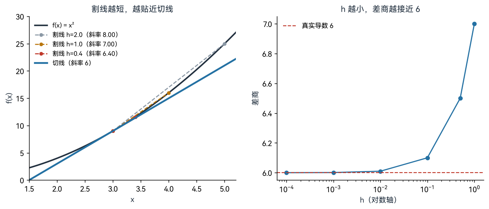
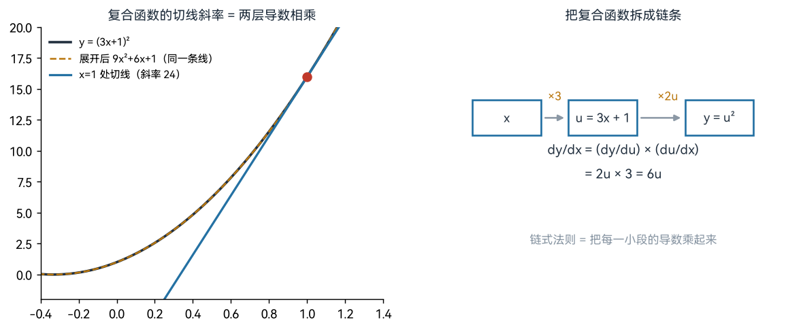
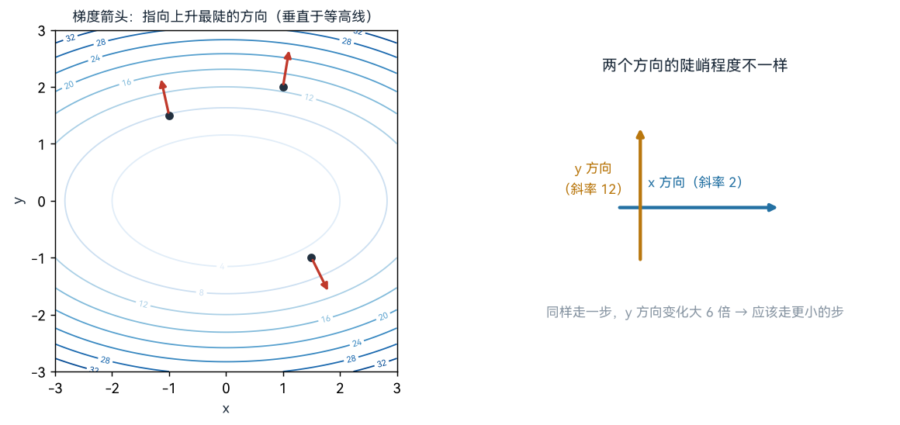
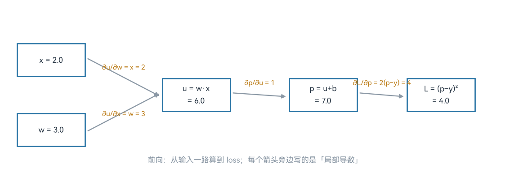
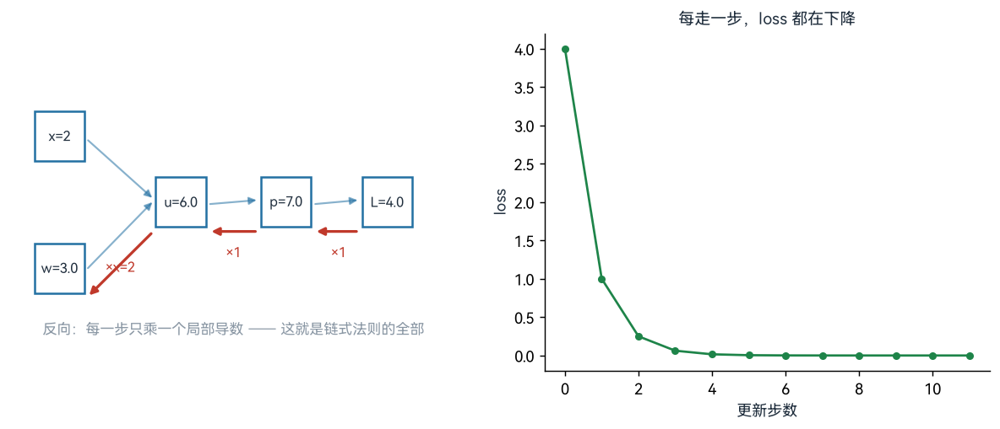
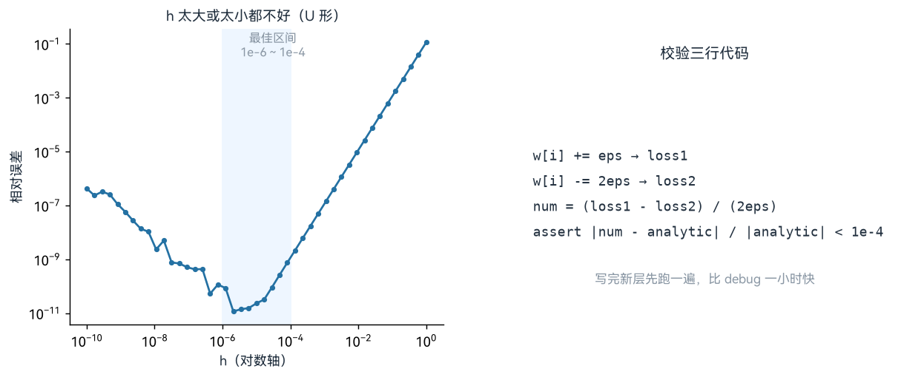
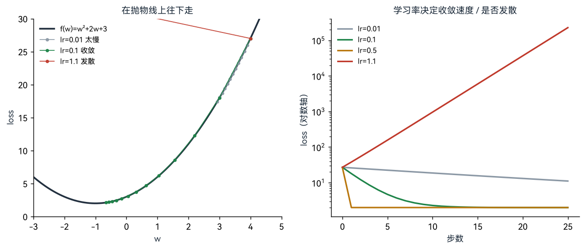

# 02 · 微积分 · 图文理论

> 7 节，每节：**一句话 → 图 → 公式 → 直觉 → 在 AI 里的位置**。配 `FORMULAS.md` 可逐步手算。

## 第 1 节 · 导数是"变化率"



**一句话**：导数 = 这一点上的切线斜率 = 瞬时变化率。

```
f'(x) = lim_{h→0} [f(x+h) − f(x)] / h
```

**直觉**：两点连线叫割线，两点靠近一点，割线就越来越像切线；极限位置就是切线。

**在 AI 里**：loss 对参数的导数 = 「参数加一点点，loss 变多少」。有了它才知道往哪调。

---

## 第 2 节 · 求导规则（尤其链式法则）



**一句话**：幂法则 `(xⁿ)' = n·xⁿ⁻¹`；复合函数要「外层导数 × 内层导数」。

```
(f(g(x)))' = f'(g(x)) · g'(x)
```

**直觉**：像换挡 —— 齿轮比是乘起来的。`y=(3x+1)²` 在 x=1 处：外层 2u=8，内层 3，乘起来 24。

**在 AI 里**：loss 是「多层复合函数」，W 在最里层，只能一层层乘回去 —— 这就是反向传播。

---

## 第 3 节 · 偏导与梯度



**一句话**：偏导 = 只对一个变量求导（其他当常数）；梯度 = 所有偏导排成的向量 = 最陡上升方向。

```
f(x,y) = x² + 3y²
∂f/∂x = 2x        ∂f/∂y = 6y
∇f = (2x, 6y)     ‖∇f‖ = 陡峭程度
```

**直觉**：站在山坡上，梯度箭头指向最陡的上坡；想下山就走它的反方向。

**在 AI 里**：参数上万维时，「梯度」就是万维向量；每个分量都按同样规则算。

---

## 第 4 节 · 计算图



**一句话**：把复合函数拆成一串简单节点，每个节点只记两件事 —— **值** 和 **局部导数**。

```
u = w·x   (∂u/∂w = x)
p = u+b   (∂p/∂u = 1)
L = (p−y)² (∂L/∂p = 2(p−y))
x=2, w=3, b=1, y=5 → u=6, p=7, L=4
```

**直觉**：复杂函数求导之所以难，是因为一次看不完；拆成节点后，每一步都只是「乘法/加法/平方」的导数。

**在 AI 里**：PyTorch 的 autograd 就是自动建这张图并自动求导。

---

## 第 5 节 · 反向传播



**一句话**：`dL/d输入 = 上游梯度 × 局部导数`，从 loss 一路乘回输入。

```
dL/dp = 2(p−y)     = 4
dL/du = dL/dp × 1  = 4
dL/dw = dL/du × x  = 8
dL/db = dL/dp × 1  = 4
```

**直觉**：责任分摊 —— 输出错 4 分，乘法节点按输入大小分下去（x=2 就乘 2），加法节点原样传。

**在 AI 里**：这正是 `ai-from-scratch` 里 `dW = hᵀ·dp` 的来源；批量时把「乘」换成矩阵乘。

---

## 第 6 节 · 数值梯度校验



**一句话**：用 `[f(x+h)−f(x−h)]/(2h)` 近似导数，和解析值比，误差 < 1e-4 就算对。

```
h 太大 → 截断误差（直线代替曲线）
h 太小 → 浮点误差（相近数相减）
最佳区间：1e-6 ~ 1e-4
```

**直觉**：这是「不看公式也能验证」的唯一手段；写完任何新层，先跑一遍。

**在 AI 里**：框架内部也有 gradcheck；自己写层时更是救命工具。

---

## 第 7 节 · 梯度下降



**一句话**：`w ← w − lr · dL/dw`；lr 太小走不动，太大震荡/发散。

```
lr=0.01 → 25 步还没到（loss 11.1）
lr=0.1  → 收敛到 w=−1, loss=2.000 ✅
lr=1.1  → 误差每步 ×1.2 → 发散（loss 22 万）
```

**直觉**：下山时步子迈太大就会跨过山谷、越走越高。对二次函数，误差每步乘 `|1−2·lr|`，>1 就炸。

**在 AI 里**：这就是训练循环里那行 `P -= lr * grad`；Adam 只是把「步子」改成自适应。

---

## 一页串起来

```
导数（第1节）→ 求导规则（第2节）→ 偏导/梯度（第3节）
      ↓                                    ↓
  拆成计算图（第4节）→ 反向传播（第5节）→ 梯度下降（第7节）
                            ↑
                     数值校验（第6节）保证没算错
```
